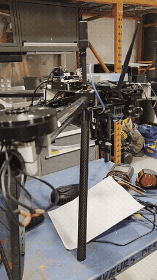
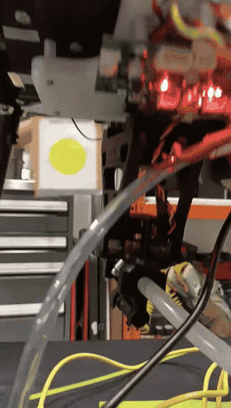

# ros2-water-gun-aiming
ROS 2 autonomous UAV target detection and ballistic aiming pipeline in Rust and Python (YOLO, LiDAR, serial payload control).

## Demos

*Click any preview to view the full-resolution MP4.*

| Turret Actuation | Full-UAV Target Tracking | Live Tracking Close-Up |
| :---: | :---: | :---: |
|  |  |  |
| [Full video (MP4)](media/turret_actuation.mp4) | [Full video (MP4)](media/uav_target_tracking.mp4) | [Full video (MP4)](media/live_tracking_closeup.mp4) |
