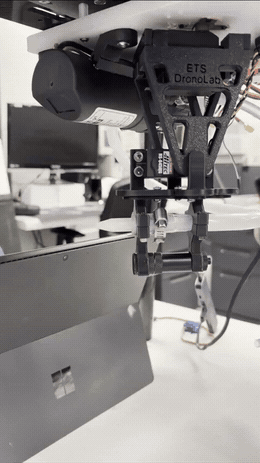

# ros2-water-gun-aiming

Target detection, ballistic aiming, and serial turret control for Dronolab's autonomous UAV water-gun payload (ÉTS Montreal, built for the AEAC competition).

This repo is a standalone extract of the vision and aiming packages from our main ROS 2 autonomy stack.

## Demos

*Click any preview to open the full-resolution MP4.*

| Turret Actuation | Full-UAV Target Tracking | Live Tracking Close-Up |
| :---: | :---: | :---: |
| [](media/turret_actuation.mp4) | [](media/uav_target_tracking.mp4) | [](media/live_tracking_closeup.mp4) |
| [Full video (MP4)](media/turret_actuation.mp4) | [Full video (MP4)](media/uav_target_tracking.mp4) | [Full video (MP4)](media/live_tracking_closeup.mp4) |

## How it works

There are three ROS 2 packages under `ros2/`:

- **`drone_image_detection` (Python / `rclpy`)** — Runs YOLO (`targets.pt`) on `/camera/image_raw`, undistorts the detected target center using our SIYI A8 camera calibration (`siyi_a8_calib.npz`), and publishes a 3D camera-frame direction vector on `/yolo/unit_vector`.
- **`water_gun_zeroing` (Rust / `rclrs`)** — Two executables:
  - `water_gun_zeroing_node` subscribes to `/lidar/target_info` (`TargetObservation`), shifts the target from the LiDAR frame to the water-gun mount offset, solves the direct-fire ballistic trajectory (no drag), and publishes yaw/pitch on `/water_gun/aim_angles` (`AimSolution`).
  - `water_gun_controller_node` subscribes to `/water_gun/aim_angles`, validates mechanical limits (`pitch: -90°..25°`, `yaw: -90°..90°`), and sends `<pitchP;yawY>` over serial (`/dev/ttyACM0`, `115200` baud) to the onboard microcontroller. It also exposes `/water_gun/shoot` (`Shoot.srv`) to fire for `500..2000 ms` (`<shootMS>`).
- **`drone_interfaces` (`ament_cmake`)** — Shared ROS 2 message and service definitions (`TargetObservation.msg`, `AimSolution.msg`, `UnitVector.msg`, `Shoot.srv`).

```text
/camera/image_raw ──► yolo_detector ──► /yolo/unit_vector (UnitVector)

/lidar/target_info (TargetObservation)
        │
        ▼
water_gun_zeroing_node  (LiDAR-to-turret offset + ballistic solver)
        │
        ▼  /water_gun/aim_angles (AimSolution)
water_gun_controller_node ──► serial (/dev/ttyACM0 @ 115200)
        ▲
        │  /water_gun/shoot (Shoot.srv)
```

## Building and testing

Requires a ROS 2 environment with `colcon`, `ament_cargo` / `rclrs` (`0.7.0`), and `ultralytics` + OpenCV for the Python detector.

Build `drone_interfaces` first so `ros-env` can pick up the generated Rust bindings:

```bash
colcon build --base-paths ros2 --packages-select drone_interfaces
source install/drone_interfaces/local_setup.bash
colcon build --base-paths ros2 --packages-select drone_image_detection water_gun_zeroing
source install/setup.bash
```

Run the Rust unit tests (ballistic solver + serial command/range validation):

```bash
cargo test --manifest-path ros2/water_gun_zeroing/Cargo.toml
```

### Quick manual test

```bash
# Start the ballistic solver
ros2 run water_gun_zeroing water_gun_zeroing_node

# Publish a sample target 10 m straight ahead
ros2 topic pub --once /lidar/target_info drone_interfaces/msg/TargetObservation \
  "{distance_m: 10.0, horizontal_angle_deg: 0.0, vertical_angle_deg: 0.0}"

# Start the turret controller and test firing (requires MCU on /dev/ttyACM0)
ros2 run water_gun_zeroing water_gun_controller_node
ros2 service call /water_gun/shoot drone_interfaces/srv/Shoot "{duration_ms: 750}"

# Start the YOLO detector (mode:=dev writes annotated frames to ./webcam_frame_pred.png)
ros2 run drone_image_detection yolo_detector --ros-args -p mode:=prod
```

## Contributors

Built by members of **Dronolab (ÉTS Montreal)**:

- **Thomas Duplessis** ([@Mephistos121](https://github.com/Mephistos121)) — ROS 2 integration, camera pipeline, `AimSolution` wiring
- **Juliann Lamothe** ([@LJuliann](https://github.com/LJuliann)) — `water_gun_zeroing` Rust/`rclrs` port and `drone_interfaces` messages
- **Isaac David Zolana** ([@HiZackDavid](https://github.com/HiZackDavid)) — `water_gun_controller_node` serial aiming/shoot service and unit tests
- **Simon Pomerleau** ([@SimonPomerleau](https://github.com/SimonPomerleau)) — YOLO target detection node, SIYI A8 calibration, and unit-vector projection
- **Nicolas Marin** — dev-mode detection visualization

## License

Apache 2.0 — see [LICENSE](LICENSE).
